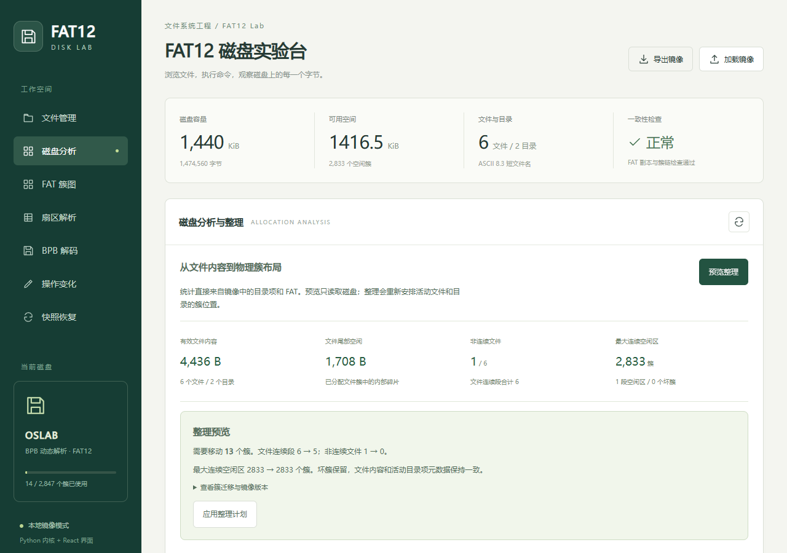

# FAT12 Disk Lab

A byte-level FAT12 image workbench with **allocation analysis, verified compaction, guarded persistence, and an inspectable React interface**.

FAT12 is an older floppy-disk filesystem. This educational project lets you explore its disk-image structure, inspect files and see how a compaction plan rearranges stored data. It runs locally and includes checks for the cases documented below.

[](https://github.com/Derek-Qi/FAT12-Disk-Lab/actions/workflows/ci.yml)

[中文说明](README.zh-CN.md) · [Architecture](docs/architecture.md) · [Reproduce the experiment](docs/experiments.md) · [Testing](docs/testing.md)

The [bilingual evidence matrix](docs/experiments.md#research-style-evidence-matrix-english) separates observed results from limitations and future validation; [portfolio material](docs/portfolio.md#bilingual-application-material--中英文申请素材) describes the work and its AI assistance.



## What this project demonstrates

The engine reads and writes the disk image itself: BPB fields, two packed 12-bit FATs, directory entries, file contents, and fragmented cluster chains. It does not replace a disk with a host directory or delegate runtime operations to an existing FAT library.

The main engineering question is how to rearrange a volume while preserving its active contents and making failure behavior inspectable:

- Analyze logical/allocated bytes, internal slack, fragmented files, extents, free runs, and bad clusters.
- Preview deterministic compaction without changing a byte; bind the plan to the image SHA256.
- Relocate files and expanded directories, rewrite parent and dot references, preserve metadata, and skip bad clusters.
- Validate the replacement, save a full protection snapshot, then persist with an OS lock, content-version check, temporary-file fsync and atomic replacement.
- Recover verified snapshots, diagnose damaged images, and inspect safely in read-only mode.
- Share the same engine across 32 commands, HTTP endpoints, and seven interface views. Jump from a cluster chain to its FAT bytes and data sector.

## Run locally

Python **3.11+**; no third-party Python runtime dependencies. The prebuilt interface is included. Its current labels are Chinese; commands, JSON keys and developer documentation are usable in English.

```sh
git clone https://github.com/Derek-Qi/FAT12-Disk-Lab.git
cd FAT12-Disk-Lab
python -m fat12lab --image data/demo.img --read-only --web
```

For a writable experiment, copy `data/demo.img` to a new path and open that copy. On Windows, `start.bat` creates `data/work.img` from the demo if it does not exist; `cli.bat` opens the command interface.

```sh
python -m fat12lab --image my-disk.img --create --web
python -m fat12lab --image data/demo.img --read-only -c analyze
```

The service listens on loopback only. This is a desktop/local tool, not a multi-user Internet service.

## Preview and compact

```python
from fat12lab import FAT12

fs = FAT12.open("my-copy.img")
report = fs.analyze()                 # read-only
plan = fs.plan_defragmentation()      # read-only, deterministic for these bytes
if plan["moved_clusters"]:
    fs.defragment(plan["image_sha256"])
assert fs.check()["ok"]
```

The shared shell supports `analyze`, `defrag --dry-run`, and `defrag <preview SHA256>`. A changed preview is refused. The interface presents before/after counts and asks for confirmation before applying. A persisted compaction first saves an exact protection snapshot.

Compaction preserves **active file bytes and directory metadata**. It can clear previously free cluster contents; use read-only inspection for forensic work. Packing follows sorted paths and avoids bad clusters; it is not claimed to be a globally optimal layout.

## Reproducible evidence

```sh
python -m unittest discover -s tests -v
python tools/verify_project.py
python tools/compaction_experiment.py
```

The fixed-seed experiment covers a 1.44MB floppy layout (1,474,560 bytes), a 720KiB layout with 1,024-byte clusters, and an interleaved bad cluster. In the two ordinary layouts, file extents change **33 → 23**, with matching before/after content-and-metadata hashes. Preview leaves the image byte-identical; a second plan moves zero clusters.

These are **layout and preservation results**, not measured disk-speed gains. Per-run timestamps and hashes are recorded in [compaction-results.json](artifacts/compaction-results.json). [Test receipts](artifacts/test-results.json), [browser receipts](artifacts/browser-results.json), and [independent interoperability](artifacts/interop-results.json) contain their actual dates and environments.

Tests include seeded model checks, nested/expanded directories, binary and empty files, FAT packing boundaries, stale writers/previews, rollback, snapshot corruption, HTTP guards, and real child-process termination immediately before/after image replacement. Process-termination checks are not power-loss tests.

Optional independent validation uses `pyfatfs==1.1.0` and `setuptools<81` in an isolated environment. It reads every compacted file and writes back through the independent implementation. The library is not used by the runtime.

## Installable release

Download the wheel/source archive from [GitHub Releases](https://github.com/Derek-Qi/FAT12-Disk-Lab/releases). No PyPI publication is claimed.

```sh
python -m pip install fat12_disk_lab-1.2.1-py3-none-any.whl
fat12lab --version
fat12lab --image my-disk.img --create --web
```

For development, Node.js 22.12+ or 24:

```sh
cd web
npm ci
npm run build
cd ..
python -m pip install "setuptools>=68" wheel
python tools/build_wheel.py
python tools/check_distribution.py artifacts/releases/fat12_disk_lab-1.2.1-py3-none-any.whl
```

The wheel builder stages a fresh source tree and verifies every module/static asset, avoiding stale incremental build output. The clean-install check runs outside the repository. CI covers Windows/Linux, Python 3.11/3.13, frontend builds, installation and browser behavior; consult the actual Actions run rather than inferring a pass from this configuration.

## Design and limits

Whole-image memory transactions are deliberately simple for volumes up to **16MiB**. The cost is full-image copying and consistency checks per modification. The engine supports naked FAT12 volumes, ASCII 8.3 names, 512-byte sectors, two FATs and a fixed root directory. It does not implement partitions, FAT16/32, long filenames, a bootable OS, automatic field repair, or a power-loss journal.

The sidecar OS lock coordinates this project's writers; uncooperative tools must be used separately. Version conflicts preserve the newer disk and the stale instance's previous memory. Reload before retrying. A shared `FAT12` instance requires caller serialization; HTTP already serializes it.

Snapshots are full image/JSON pairs beside the working image, verified by size, SHA256 and filesystem checks. The digest detects damage, not authenticity. Recovery keeps an unhealthy prior image as a non-restorable analysis copy. There is no automatic retention cleanup. Directory-link checks do not claim protection against a malicious local process racing filesystem changes.

## Provenance

This project grew from an operating-systems course exercise. The author completed the project individually, using AI assistance and incorporating some AI-generated content. AI also assisted later improvements, testing, and documentation. Claims here describe inspectable software and recorded checks; they do not imply a research publication or a production filesystem driver.

The public tree deliberately excludes inherited books/images, old course reports/slides, private work images and local history. Format references and bundled third-party notices are listed in [NOTICE.md](NOTICE.md). No new project-wide open-source licence has been selected.
