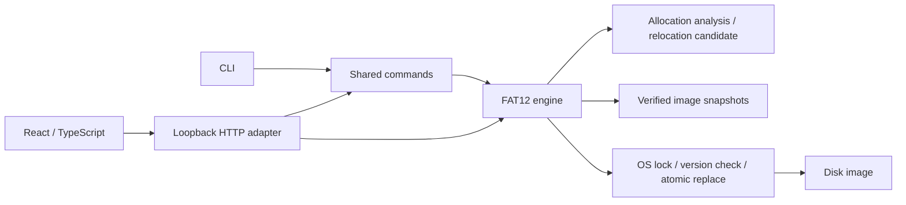

# Architecture and design decisions

## Byte model

A parsed, immutable `Layout` derives FAT, root-directory and data offsets from the BPB. Cluster n starts at `DataLBA + (n-2) * SectorsPerCluster`. Two 12-bit FAT entries share three bytes; updates preserve the adjacent half-byte in both copies. Directory entries are 32 bytes; root capacity is fixed, while subdirectories can grow by appending clusters.

The volume is the source of truth. Host folders are not used to simulate its contents. ASCII 8.3 filenames and exact image length are validated; unsupported layouts and truncated/padded containers are refused.

## Allocation analysis and compaction

`allocation.py` has two responsibilities: measurements and construction of a replacement. It does not save a disk or create snapshots.

1. Check consistency, walk active objects, and measure chain extents and file slack. Free runs exclude bad clusters.
2. Sort objects by their full image paths. Map their logical chain order onto the lowest usable clusters, skipping bad clusters.
3. Construct a separate image. Copy from immutable source bytes, rebuild both FATs, and rewrite active directory first-cluster fields at their relocated offsets. This includes expanded directory chains and `.` / `..` references; the root stays fixed.
4. Preserve volume geometry, boot bytes, file contents, attributes, timestamps and sizes. Keep bad-cluster markers and bytes. Free-cluster bytes can be cleared.
5. Check the candidate and report before/after metrics. The preview contains the source-image SHA256, so a caller cannot apply a plan to different bytes or supply its own mapping.
6. Apply only a non-empty matching plan. For persisted images, save a complete protection point before using the existing transaction boundary.

Sorted-path packing is deterministic and idempotent; it is not a global optimization solver. Bad clusters can still interrupt an object's physical run. Extents describe adjacency, not device speed. Internal slack is determined by file sizes and cluster size and is not eliminated by relocation.

## Persistence and concurrency

A command retains the old in-memory image, layout and loaded disk digest. Ordinary mutations require a healthy starting filesystem; restore validates a healthy replacement even when the current filesystem is damaged. After modification, validate BPB and ownership/chain consistency again.

Storage acquires an OS lock on a stable sidecar, checks the current disk SHA256 against the loaded version, writes/fsyncs a same-directory temporary file, then atomically replaces the image. An exception rolls back the in-memory image and digest. The sidecar file remains; the OS releases its lock even when the writer dies. Creating a new image refuses an existing target by default.

The protocol coordinates cooperating instances, not arbitrary editors or sync clients. Direct calls on a single FAT12 instance must be serialized by the caller; HTTP uses a reentrant lock. The API is local and validates loopback Host and same-origin requests.

## Snapshots and damaged images

Snapshot IDs are random 32-character hexadecimal values. Payload and bounded JSON metadata form an immutable pair. Metadata is published last. Restore verifies size, SHA256 and filesystem consistency, saves the current raw bytes, then writes through the guarded persistence boundary.

If the current image has a readable BPB but a damaged FAT, reload can expose that state for diagnosis. Ordinary writes remain blocked. A raw damaged recovery point is marked `restorable=false`; both API and UI refuse restoring it. A severely damaged BPB requires rebuilding a copy from a healthy snapshot payload.

The snapshot root must remain the expected image-adjacent directory; child paths must remain within it. These checks do not claim race-proof isolation from a malicious local process. SHA256 is damage detection, not a signature. Retention and backup to another device are user decisions.

## Deliberate tradeoffs

- Whole-image memory transactions favor clarity and verifiability for at most 16MiB; each write copies/checks the image.
- Full snapshots make recovery easy to inspect, at a storage cost. There is no automated pruning or cross-file transaction for snapshot publication plus image commit.
- Temporary-file fsync and atomic replacement are tested at process-termination boundaries. Directory-entry durability across sudden power loss is not claimed; there is no journal/replay protocol.
- The browser is an adapter to Python. A static portfolio page shows actual screenshots and evidence rather than pretending to run the native engine.
- LFN, FAT16/32, partitions, booting an OS and automatic consistency repair are outside the current format contract.
